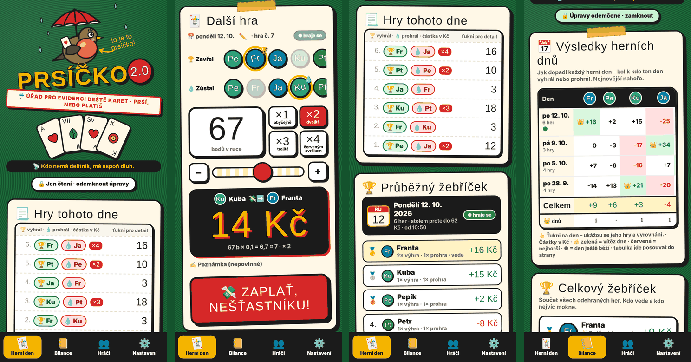

# ☔ Prsíčko 2.0

Počítadlo karetní hry **prší** pro partu u stolu. Mobilní webová aplikace bez databázového serveru – stačí `index.html`, `api.php`, logo a jeden JSON soubor.

<p align="center"></p>

## Funkce

- 🃏 **Herní den** – večer se otevře den, hry se zapisují pod něj, po ukončení vznikne žebříček dne.
- 🎚️ **Rychlý zápis** – vítěz, poražený, body v ruce (posuvník) a násobek; částka se počítá živě.
- 💰 **Platba** – body × koeficient, zaokrouhlit na celé, × násobek zavření.
- 📃 **Přehled her** – každá hra na jeden řádek: 🏆 vítěz · 💧 poražený · částka, detail na ťuknutí.
- 📅 **Bilance** – výsledky po dnech, celkový žebříček, kdo komu dluží, statistiky.
- 🤝 **Vyrovnání** – dluhy mezi dvojicí se vzájemně odečtou, zaplacené se odškrtnou.
- 🎯 **Zkratky hráčů** – u stolu se hráč ukazuje jedinečnou zkratkou.
- ✏️ **Opravy** – upravit jde vše zapsané: hry, data dnů, hráče, vyrovnání.
- 🔒 **Heslo** – číst může každý, zapisovat jen se znalostí hesla.
- 👥 **Sdílené** – data leží na serveru, všechna zařízení vidí totéž.

## Jak se počítá

### Platba za hru

Platí jen poražený (zůstal s kartami) vítězi (zavřel).

```
platba = zaokrouhlit(body v ruce × koeficient) × násobek
```

| Koeficient | Hra | Výpočet | Platba |
|:---:|---|---|---:|
| 0,1 | 67 b, ×2 | 6,7 → 7 × 2 | **14** |
| 0,1 | 64 b, ×2 | 6,4 → 6 × 2 | **12** |
| 0,1 | 65 b, ×1 | 6,5 → 7 | **7** |
| 1 | 67 b, ×2 | 67 × 2 | **134** |

- Výsledek je vždy v celých jednotkách měny (0,5 nahoru).
- Koeficient, měna a násobky (výchozí ×1–×4) se nastavují v aplikaci.
- Zapsané hry si pamatují koeficient, se kterým se hrály.

### Vyrovnání

Dluhy se počítají po dvojicích a vzájemně se odečtou:

| Hra | Dluh |
|---|---|
| A prohrál s B | A → B 14 |
| B prohrál s A | B → A 12 |
| **Výsledek** | **A → B 2** |

- Nic se nepřevádí přes třetího hráče.
- Vyrovnání dne ukazuje stav za jeden večer, Bilance za všechny dny po odečtení zaplaceného.
- Zaplacení nemění žebříček – ten se počítá jen z her.

### Zkratky hráčů

Výchozí zkratka jsou první dvě písmena přezdívky. Je-li obsazená, použije se další písmeno, u dvou slov iniciály, jinak číslo. Zkratku lze přepsat; duplicitní aplikace nepovolí.

## Instalace

Potřeba je webový server s **PHP 7.4+**.

1. Nahraj `index.html`, `api.php` a složku `img/` do jedné složky.
2. Vytvoř vedle nich složku `data/` s právem zápisu pro PHP.
3. Zakaž přímý přístup ke složce `data/`.
4. Otevři aplikaci a v **Nastavení** zvol heslo.

> ⚠️ Heslo nastav hned po instalaci – dokud není nastavené, zvolí ho první návštěvník.

### Debian / Ubuntu s Caddy

```bash
bash <(curl -fsSL https://raw.githubusercontent.com/hensnn/Priscko/main/install-caddy.sh)
```

Skript nainstaluje PHP, nahraje aplikaci do `/var/www/prsicko` a přidá do `Caddyfile` samostatný web na prvním volném portu od `8080` (adresu vypíše na konci). Původní `Caddyfile` zazálohuje, ostatní weby nemění; když by se Caddy s novým nastavením nespustil, zálohu sám vrátí. Opětovné spuštění aplikaci aktualizuje a zachová data, heslo i port.

Jiná složka nebo port:

```bash
PRSICKO_DIR=/var/www/prsi PRSICKO_PORT=8090 bash <(curl -fsSL https://raw.githubusercontent.com/hensnn/Priscko/main/install-caddy.sh)
```

### Bez serveru

Bez PHP (např. GitHub Pages) běží aplikace v offline režimu – data se ukládají jen v prohlížeči.

## Data a záloha

| Soubor | Obsah |
|---|---|
| `data/prsicko.json` | hráči, herní dny, hry, vyrovnání, nastavení |
| `data/prsicko.bak.json` | předchozí verze (ukládá se automaticky) |
| `data/auth.json` | otisk hesla |

Zálohu lze stáhnout i v aplikaci (**Nastavení → Stáhnout databázi**). Obnova = nahrát soubor zpět jako `data/prsicko.json`.

## Soubory

| Soubor | Popis |
|---|---|
| `index.html` | aplikace – vzhled a logika |
| `api.php` | ukládání dat, kontrola hesla, výpočty |
| `img/` | logo a ikony aplikace |
| `install-caddy.sh` | instalace a aktualizace pro Debian/Ubuntu s Caddy |
| `docs/` | obrázky k README |
